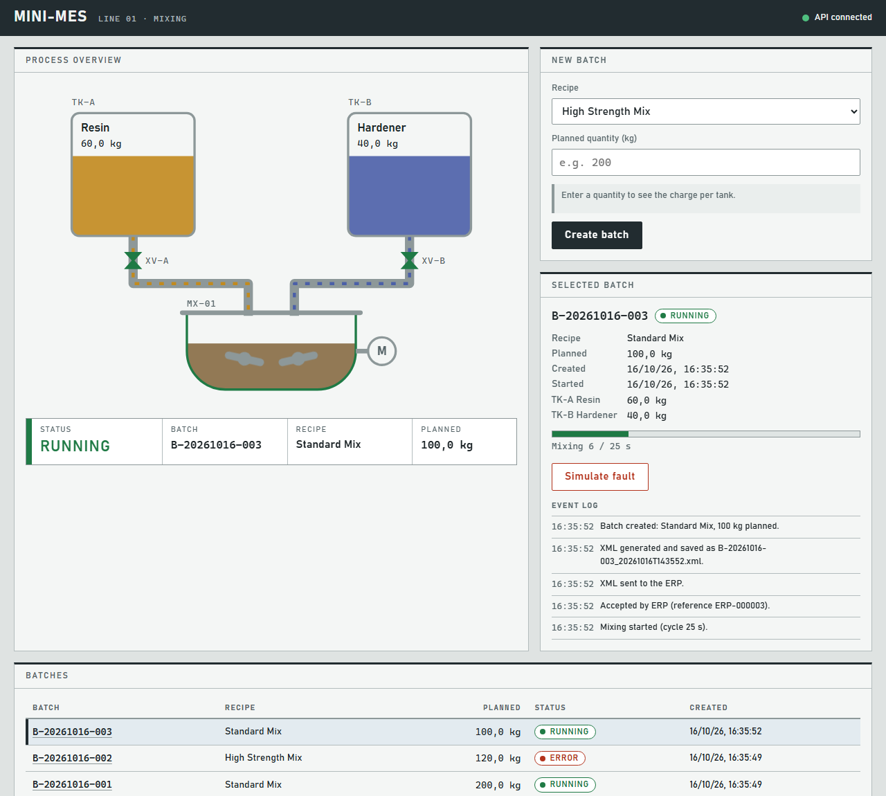
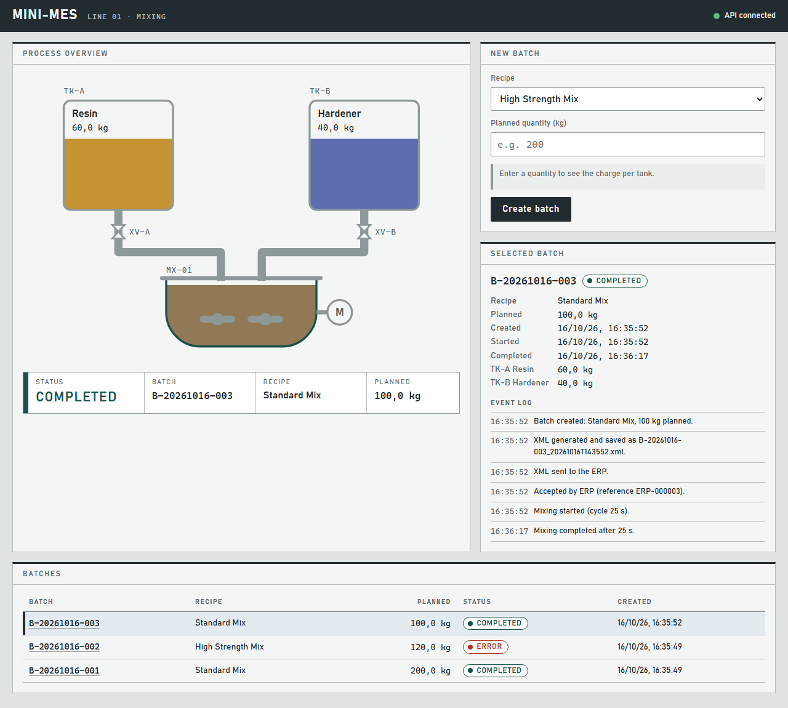
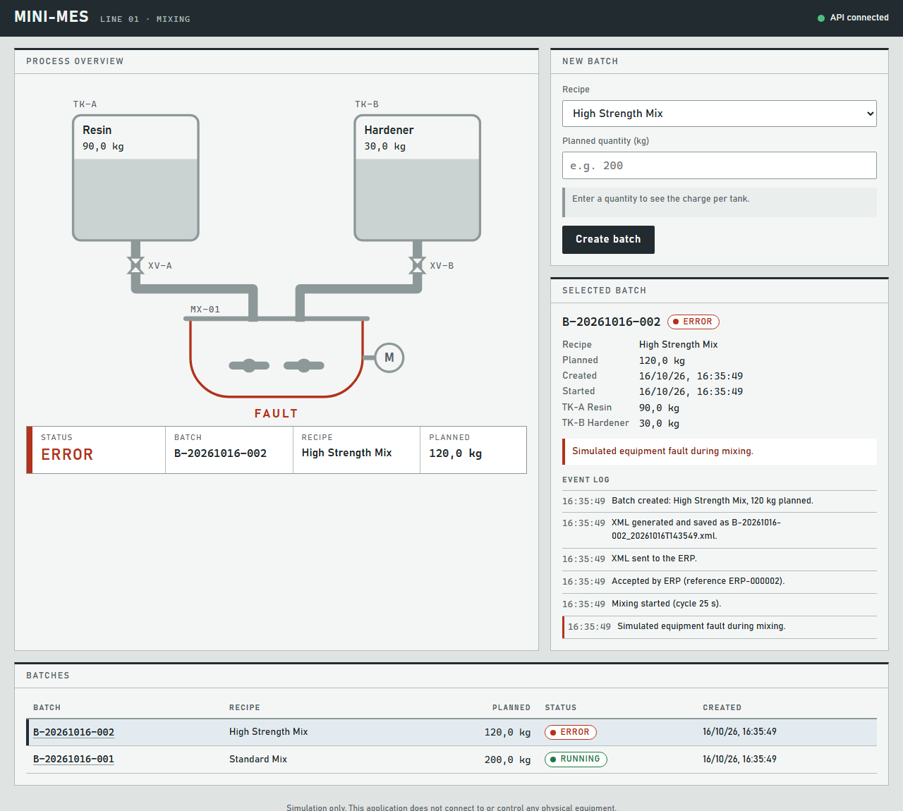
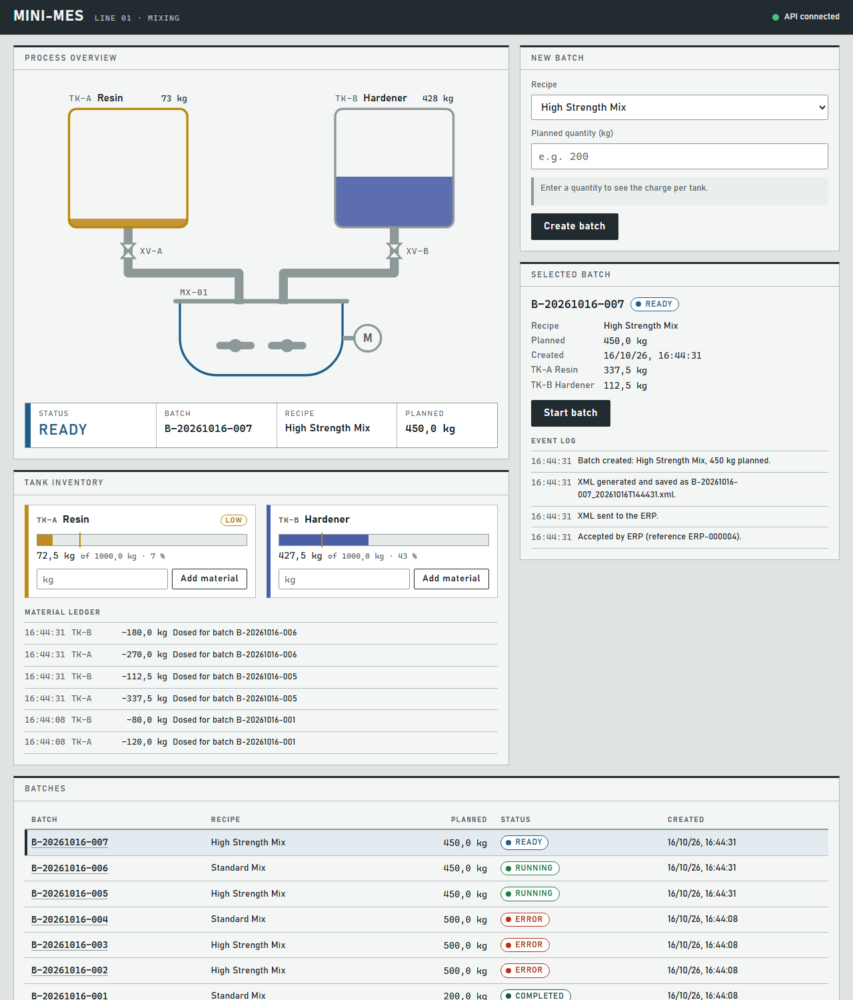
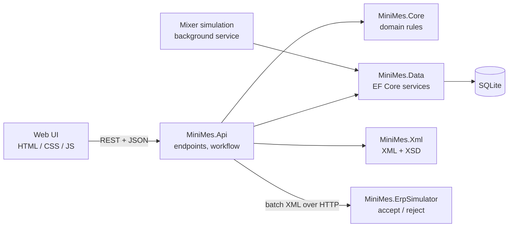
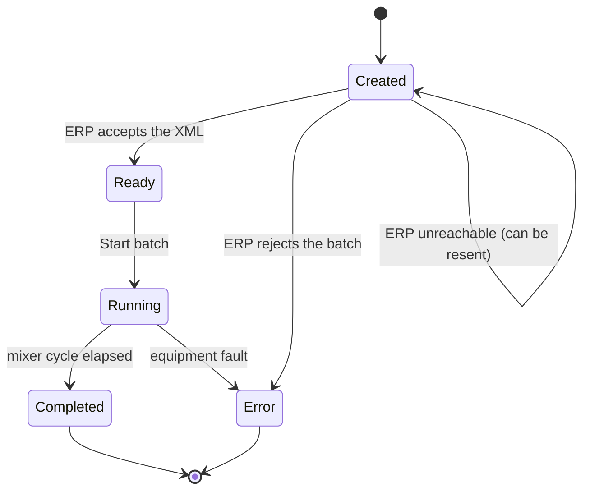

# Mini-MES — Industrial Batch Management System

A small, simulated **MES (Manufacturing Execution System)** for an industrial mixing process.
Two supply tanks (A and B) feed a trough mixer. An operator creates a batch, the system stores it,
exports it as validated XML, sends it to a separate simulated ERP that accepts or rejects it, and then
runs the mixing cycle while a live process schematic follows the batch.

> **Simulation only.** There is no PLC communication and no control of physical equipment.



## What it demonstrates

| MES topic | Where it shows up |
|---|---|
| Batch / recipe management with validation | `Batch` and `Recipe` enforce their own rules (quantity limits, percentages = 100 %) |
| Batch state machine | `Created → Ready → Running → Completed`, with `Error` as a terminal state |
| Relational persistence | EF Core + SQLite, migrations, foreign keys, enum-as-text columns, UTC handling |
| System-to-system integration | Batch XML sent over HTTP to a **separate** ERP simulator |
| Data contracts | XML namespace + **XSD** schema, validated before sending *and* on receipt |
| Failure handling | "Rejected" is final; "ERP unreachable" is temporary and the batch can be resent |
| Traceability | Per-batch event log (audit trail) in the database, plus application logging |
| Operator HMI | Live P&ID-style schematic: valves, flow, rotors, blended mixer content |
| Background processing | A hosted service completes mixing cycles; start times are stored, so restarts are safe |
| Material inventory and traceability | Tank levels, dosing at batch start, low-level warnings, manual refills, and a ledger linking every kg to the batch that used it |

## Screenshots

| Completed | Error (ERP rejection or simulated fault) |
|---|---|
|  |  |

**Tank inventory:** TK-A is low (amber outline, `LOW` flag), and the ledger shows which batch consumed what.



## Architecture



| Project | Responsibility |
|---|---|
| `src/MiniMes.Core` | Domain models and business rules. No web or database dependencies. |
| `src/MiniMes.Data` | `DbContext`, migrations, seed data, `BatchService` (use cases that touch the database). |
| `src/MiniMes.Xml` | XML generation and XSD validation (the schema is embedded in the DLL). |
| `src/MiniMes.Api` | Minimal API endpoints, ERP client, submission workflow, mixer simulation, and the web UI in `wwwroot/`. |
| `src/MiniMes.ErpSimulator` | A separate service playing the external ERP. |
| `tests/MiniMes.Tests` | xUnit unit and integration tests (130). |
| `start.ps1` / `stop.ps1` | Launch and stop both services with one command (`.cmd` wrappers included). |

### Batch lifecycle



### Material inventory

Each container has a tank (1000 kg capacity, seeded at 800 kg). Starting a batch **doses** the recipe's quantities
out of the tanks:

- All tanks are checked first. If any cannot supply its share, **nothing is consumed**, the batch stays `Ready`, and the
  error says which tank is short. Refill it and start again.
- Each dose is written to a **material ledger** (`TankMovement`) together with the batch ID, so you can answer
  "which batches used this material?".
- Material is **not returned** if the batch later faults: it was already added to the mixer.
- At or below 20 % a tank is flagged `LOW`. Operators top tanks up from the screen; a refill that would exceed the
  capacity is refused.

### Sending a batch to the ERP

1. The batch XML is generated and **validated against the XSD** before it leaves the system.
2. The XML is stored **exactly as sent** in the `BatchXmlMessages` table (one row per attempt) and a copy is written to
   `output/xml/`.
3. The XML is posted to the ERP simulator.
4. The answer decides the outcome. *Accepted* → `Ready`. *Rejected* → `Error` (with the ERP's reason).
   *Unreachable / timeout / 5xx* → no decision was made, so the status does **not** change.
5. The message row is updated with how the exchange ended (`Accepted`, `Rejected` or `Unavailable`, plus the ERP
   reference or the reason). A resend after an outage therefore leaves two rows: the failed attempt and the good one.

## Run it

Requirements: [.NET 8 SDK](https://dotnet.microsoft.com/download/dotnet/8.0). Nothing else — SQLite is a single file.

### One command

```powershell
.\start.cmd          # builds, opens the two services in their own windows, then opens the browser
.\stop.cmd           # stops both
```

`start.cmd` runs `start.ps1` with the execution policy bypassed for that one run, so it works even where PowerShell
scripts are blocked. Options: `-NoBrowser` (don't open the browser) and `-NoWait` (return immediately and leave the
windows running). If a port is already taken, the script says so instead of failing halfway.

### Or by hand

Both programs are servers, so use **two terminals** from the repository root:

```powershell
# Terminal 1 — the external ERP (http://localhost:5063)
cd src\MiniMes.ErpSimulator
dotnet run --launch-profile http
```

```powershell
# Terminal 2 — Mini-MES API + web UI (http://localhost:5062)
cd src\MiniMes.Api
dotnet run --launch-profile http
```

Open **http://localhost:5062**. The database (`minimes.db`) is created and seeded with two recipes on first start.

Try this:
1. Create a 200 kg batch → **Send to ERP** → it becomes *Ready*. → **Start batch** and watch the schematic.
2. Create a 480 kg batch and send it. The ERP's planning limit is 450 kg, so it is rejected and the batch goes to *Error*.
3. Stop the simulator and send a batch: the batch stays *Created* with an "ERP unavailable" warning.
4. While a batch is *Running*, press **Simulate fault**.
5. Start several large batches until TK-A runs low. The next **Start batch** is refused with the exact shortage;
   use **Add material** on the tank and start it again.

Add `?preview=Running` (or `Completed`, `Error`) to the URL to draw the selected batch in that state.

### Configuration (`src/MiniMes.Api/appsettings.json`)

| Setting | Default | Meaning |
|---|---|---|
| `ConnectionStrings:MiniMes` | `Data Source=minimes.db` | SQLite file |
| `Erp:BaseUrl` | `http://localhost:5063` | Where the ERP simulator listens |
| `Mixer:CycleSeconds` | `20` | Duration of a mixing cycle |
| `Output:Folder` | `output/xml` | Where sent XML files are saved |

The simulator's planning limit is `Erp:MaxQuantityKg` (default 450). It can also be switched at runtime:
`PUT http://localhost:5063/admin/mode` with `{ "mode": "Normal" | "RejectAll" | "Unavailable" }`.

## API

| Method | Route | Purpose |
|---|---|---|
| GET | `/api/config` | Mixer capacity and cycle length |
| GET | `/api/recipes` | Recipes with ingredient percentages |
| GET / POST | `/api/batches` | List batches / create a batch |
| GET | `/api/batches/{id}` | Batch detail with its event log |
| GET | `/api/batches/{id}/xml` | Preview of the XML that would be sent |
| GET | `/api/messages/{id}/xml` | An XML message exactly as sent to the ERP, read from the database |
| POST | `/api/batches/{id}/submit` | Send the batch to the ERP |
| POST | `/api/batches/{id}/start` | `Ready → Running`; doses the tanks (refused if one is short) |
| POST | `/api/batches/{id}/fault` | Simulate a fault while `Running` |
| GET | `/api/tanks` | Tank levels, capacity and low-level flag |
| GET | `/api/tanks/movements?limit=20` | Material ledger, newest first |
| POST | `/api/tanks/{A\|B}/refill` | Add material, up to capacity |

Business-rule violations return `400 { "error": "..." }`; an unreachable ERP returns `503`.
Ready-made requests are in `src/MiniMes.Api/MiniMes.Api.http`.

## Tests

```powershell
dotnet test
```

130 tests in two layers:

- **Unit tests (100)** cover the state machine, recipe and quantity rules, persistence (against a real in-memory SQLite
  engine), batch ID generation, XML generation and schema validation (including invalid documents and a Spanish-locale
  number-format check), the ERP accept/reject rules, the submission workflow with a fake ERP, the mixer timing
  including restart safety, and the tank inventory (dosing, all-or-nothing shortages, refills, ledger).
- **Integration tests (30, `tests/MiniMes.Tests/Integration`)** start the **real API and the real ERP simulator** in
  memory (`WebApplicationFactory`) and drive them over HTTP: migrations and seeding at startup, status codes and error
  bodies, the XML export, the accepted / rejected / ERP-down paths, the full `Created → Ready → Running → Completed`
  lifecycle with the background timer, tank shortages and refills. Each test gets its own SQLite file and XML folder.

The integration tests caught a real bug: a malformed JSON body returned `500` instead of `400`.

## Design decisions and trade-offs

- **SQLite** instead of SQL Server: zero setup and real relational SQL. Switching is mostly a connection-string
  and provider change.
- **Plain HTML/JS** instead of a frontend framework: no build step; the screen is one page that polls the API.
  All dynamic text is inserted with `textContent`, never `innerHTML`.
- **`BatchService` lives in the data project** and uses `DbContext` directly rather than going through a repository
  interface: fewer layers for a project this size. `IErpClient` *is* an interface, because tests need to replace
  the network call.
- **The ERP simulator shares the XSD and validator** with the main app for simplicity. A real ERP would own its own
  copy of the contract.
- **State rules live in the domain** (`Batch`), not in the endpoints, so they hold no matter who calls them.
- **Time comes from `TimeProvider`**, so tests control the clock instead of sleeping.

## Known limitations

- Two simultaneous batch creations could compute the same ID; the primary key rejects the second. A retry would be
  the production fix.
- The ERP simulator keeps its state in memory, so a restart forgets which batches it accepted.
- No authentication, Docker, or cloud deployment (out of scope for the MVP).
- Resending within the same second overwrites that exported XML file (file names have second precision).

## Possible next steps

Authentication and roles, SQL Server provider, a Docker Compose setup, OPC UA / PLC integration behind an interface,
material lots (supplier lot numbers on refills), browser-level UI tests, reporting on batch history.
